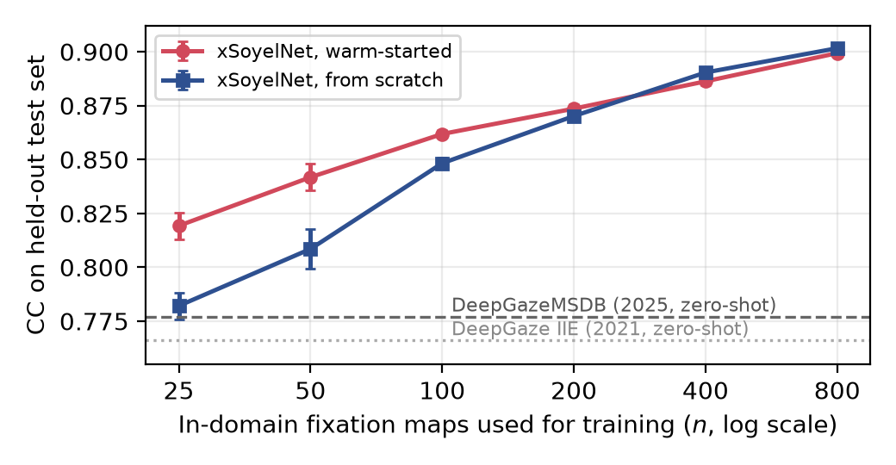

# Don't Scale, Fine-Tune

Code and results for:

> Hamit Soyel. **Don't Scale, Fine-Tune: Twenty-Five Fixation Maps Beat State-of-the-Art
> Saliency Models on Advertising Images.** IEEE Signal Processing Letters (submitted).

## The result in one paragraph

General-purpose saliency models have plateaued on advertising images: DeepGaze IIE (2021)
reaches CC 0.766 on the ADD1000 advertising fixation benchmark and its far larger 2025
successor DeepGazeMSDB reaches only CC 0.777, at roughly 50x the inference cost. Training
**xSoyelNet** — a 1.5M-parameter ASPP readout with a Gaussian finalizer on a frozen
DINOv2-base backbone — on ADD1000's own fixation maps reaches **CC 0.895±0.003** (5-fold
CV) warm-started, and **CC 0.898±0.003 from a randomly initialized readout**: the decisive
ingredient is benchmark-matched in-domain data on strong frozen features, not
saliency-specific pretraining. As few as **25 fixation maps already beat both general
models** (CC 0.819 warm-started); the warm-start advantage is confined to the low-data
regime and vanishes by n≈400.



## Fully reproducible without any private weights

The paper's warm-start checkpoint is not distributed (it derives from a commercial
product), but the **from-scratch condition needs no checkpoint at all** and matches or
exceeds the warm-started headline numbers (CC 0.898 at n=800). Everything in the main
results table is therefore reproducible from this repo plus two public downloads
(ADD1000 and the auto-downloaded DINOv2/DeepGaze weights).

## Reproduction

1. **Get ADD1000** (not redistributed here — third-party advertising creative):
   https://github.com/lscumt/ADD1000. Extract so you have the `ADD1000_*/` image folders
   and `GroundTruth1000_*/` density-map folders (the "ext" layout). For the baseline
   scripts, also make a "flat" convenience copy: `flat/images/*.jpg`, `flat/maps/*.png`
   (basenames pair images to maps).
2. `pip install -r requirements.txt`
3. Edit the `EDIT ME` path constants at the top of each script.

```bash
# Main result (Table I, from-scratch row -- no checkpoint needed): CC 0.898 +/- 0.003
python kfold_train_eval.py --folds 5 --epochs 60 --scratch

# Sample-efficiency curve (Fig. 2), from-scratch condition (CKPT=None default)
python sample_efficiency.py

# Baselines (Table I): DeepGaze IIE (CC 0.766) and DeepGazeMSDB (CC 0.777),
# both with a held-out 2-fold ad-domain center-bias prior
python eval_deepgaze_iie.py
python eval_deepgaze_msdb.py   # ~8 s/image on CPU, ~2.3 h; resumes from msdb_checkpoint.json

# Figures
python make_sampeff_fig.py     # Fig. 2 from results/*.json (pre-computed copies included)
python make_qualitative_fig.py # Fig. 1 (needs a trained checkpoint from kfold_train_eval.py)
```

Pre-computed result JSONs for every table/figure entry are in `results/`.

## Repository layout

```
kfold_train_eval.py        5-fold CV train+eval (--scratch for the no-warm-start condition)
sample_efficiency.py       CC vs training-set size (25..800), fixed held-out test set
eval_deepgaze_iie.py       DeepGaze IIE zero-shot baseline, 2-fold held-out center-bias
eval_deepgaze_msdb.py      DeepGazeMSDB (ICCV'25) baseline, generalization mode, resumable
model_aspp.py              xSoyelNet architecture: frozen DINOv2-base + ASPP readout
make_sampeff_fig.py        Fig. 2
make_qualitative_fig.py    Fig. 1
results/                   pre-computed JSONs backing every number in the paper
figures/                   pre-rendered paper figures
```

## Notes on protocol

- **Gaussian finalizer**: predictions are smoothed with sigma selected on training folds
  only (grid includes 0). Selected values are stable: sigma=12 for the untrained
  warm-started model, sigma=4 after training.
- **Metrics**: CC, SIM, KLD (distribution-based). NSS/AUC are not computable on ADD1000,
  which releases density maps only, no discrete fixation coordinates.
- **No leakage**: all reported numbers are on held-out folds/test sets; baseline
  center-bias priors are fit on the complementary fold; figure examples are drawn from
  the displayed checkpoint's held-out split.
- **Known upstream bug**: `DeepGazeMSDB.train()` does not `return self`, so a chained
  `.eval()` returns `None`. Call `model.eval()` as its own statement (our scripts do).

## License / data

- Code released under the MIT License (see `LICENSE`).
- **ADD1000 images and ground-truth maps are NOT redistributed** — obtain them from the
  dataset's own release page and observe its terms. This repo contains only code, derived
  aggregate results, and figure renderings.
- DINOv2 weights: Apache 2.0 (auto-downloaded). DeepGaze weights: see the
  matthias-k/DeepGaze repository for their terms; used here for benchmarking only.
